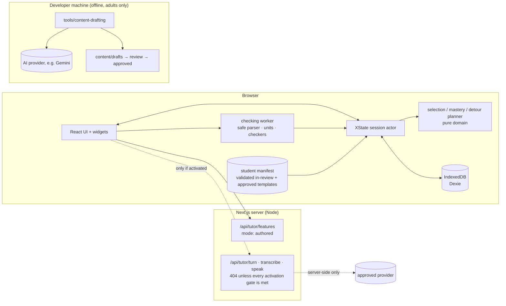

# 01 · Architecture

**Implementation status (2026-10-28):** this architecture combines the implemented Phase 1–2 foundation with later design targets. Phase 3 built the runtime config reader and the persisted session stack as a pure session record (D-064, not XState). **Phase 5 built the tutor (provider contract, authored, fixture and a prepared OpenAI adapter, all live AI disabled) and the separate drafting package** (docs/09, D-073 to D-082). The [phase plan](phase-plan.md) distinguishes working features and future prompts.

## Repository inspection (Phase 0)

`~/AI/noesis` was created empty for this project. Nothing existed to preserve or migrate, so the stack was chosen fresh to satisfy the brief and the Phase 0 decisions. Phase 0 adds only documentation, curriculum data, configuration and two dependency-free check scripts. No application code is scaffolded; that is Phase 1.

## Stack

| Concern | Choice | Why |
|---|---|---|
| Framework | **Next.js** (App Router), **React**, **TypeScript** `strict` | One codebase for the browser app and any server routes (feature flags; a provider-neutral tutor contract when enabled). Runs on any Node host. |
| Package manager | npm | Already present. Avoids adding a tool. |
| Styling | Plain CSS with design tokens as custom properties (`app/globals.css`) (D-040, supersedes D-003) | The roadmap and widgets are mostly SVG and custom components; one styling system keeps tokens directly usable by SVG and canvas code. |
| UI motion | **Motion** (`motion/react`) | Layout and shared-element transitions (detour and return), spring physics for drag settle, `useReducedMotion`. |
| Simulations | Pure TypeScript models with a fixed-timestep integrator, rendered to **SVG** (default) or **Canvas 2D** (field lines, dense plots) | Deterministic models make simulations scrubbable and replayable, and unit-testable against analytic results. |
| Roadmap pan/zoom | `d3-zoom` + `d3-selection` only | Mature wheel, drag and pinch handling. Nodes stay as React-rendered SVG and HTML buttons, so they remain accessible. |
| Roadmap layout | Deterministic layered layout in `src/domain/roadmapLayout.ts` (pure, memoised, unit-tested) (D-039) | Six chapters per view need no layout engine; results are identical on every device and are checked by tests. |
| Adaptive engine (planned, Phase 4) | **XState v5** state machine over pure domain functions | Detours are recursive child actors. The machine is inspectable and every transition is testable. |
| Persistence | **IndexedDB via Dexie**, versioned schema, JSON export/import | Browser-only progress for v1 (decision U-10). Survives reloads. Supports quitting mid-detour. |
| Schemas | **Zod** for content, config, persistence records and API payloads | One schema serves build-time validation, runtime guards and route input validation. |
| Maths display | **KaTeX** | Fast, server-renderable, no layout shift. |
| Maths input | Text field with a symbol keypad and a live KaTeX "Reads as" preview (D-049, replaces MathLive) | Works with every screen reader and phone keyboard; the preview catches misreads before checking. |
| Expression parsing | Our own safe parser and closure compiler in `src/checking/expr/` (D-048, replaces Compute Engine) | Hard input limits, no code execution; equivalence by seeded multi-point sampling (docs/05). |
| Physical units | Our own unit system in `src/checking/units.ts` (D-048, replaces mathjs) | Dimension vectors, SI prefixes, compound units, °C as absolute or difference. |
| Heavy checking | Runs in a **Web Worker** (`src/checking/worker.ts`, plain `postMessage`), warmed when a question opens | Keeps parsing and sampling off the main thread. 300 ms budget; on timeout the worker restarts and the result is `indeterminate` (D-050). |
| Student AI | **Authored tutor by default** (`src/tutor/`, `AuthoredHintsProvider`, on the device). Live tutoring is a provider-neutral contract with a prepared OpenAI adapter in `adapters/openai/` (plain fetch), compiled in only through a generated registry and used only behind every activation gate (Phase 5) | Student-facing AI stays disabled until a provider decision and privacy review are recorded (OQ-1, docs/10). No AI vendor SDK in the app. See docs/09. |
| Offline drafting (Phase 5) | Separate package `tools/content-drafting/`: no dependencies, plain fetch to Gemini or OpenAI, plus a fixture mode | Adult developers only; never imported by the app; outputs drafts that need human approval. |
| Tests | **Vitest** (unit), **fast-check** (property), **Playwright** (e2e, visual), **@axe-core/playwright** (a11y) | Covers pure logic, checkers, flows and accessibility. |
| Quality | `tsc --noEmit` and repository validation/test scripts are present; ESLint, Prettier and CI enforcement remain planned | Separate installed tooling from the target quality policy. |
| Fonts (self-hosted, `@fontsource-variable/instrument-sans`) | Instrument Sans for everything, with tabular numerals for readouts and stats; KaTeX fonts for maths from Phase 2 (D-041, supersedes D-022) | One family, so there are no third-party font requests and no separate monospace face. |

Versions are pinned at Phase 1 install time to the latest stable releases. The lockfile is committed.

## Module layout (Phase 2 baseline; planned entries labelled)

```
noesis/
  app/                         Next.js routes
    page.tsx                   Roadmap dashboard (Phase 1)
    chapter/[chapterId]/try/   Phase 2 demonstration lesson player; adaptive session later
    globals.css                tokens, motion tokens, all styles, reduced-motion rules
    api/features/              (later) feature flags; api/tutor/* only if student AI is enabled (docs/09)
  src/
    domain/                    PURE TypeScript, no React, no browser APIs
      curriculum.ts            Zod-validated graph access, views, prerequisite details
      roadmapLayout.ts         deterministic per-view layout + cross-view edges
      progress.ts              records, chapter/skill states, recommendations, panel stats, Leitner
      engine/                  (Phase 4) XState machines, selection, mastery, detour planner
    checking/                  worker/checkers, units and safe expression parser (Phase 2)
    content/                   schema, catalog, seeded instantiation, solvers, generated manifests
    persistence/               Dexie db + memory fallback, shared store, export/import/erase
    ui/                        roadmap/ (dashboard, map, preview, progress), player/ (lesson), motion
    widgets/<type>/            model.ts (pure) and View.tsx; shared controls/transport and registry
    tutor/                     (Phase 5) contract, context, guard, orchestrator, prompt, providers (authored, fixture), client, voice, server/ (activation, limits, handlers, generated adapter registry)
    ui/tutor/                  (Phase 5) TutorPanel and the OwlTutor character
  adapters/openai/             (Phase 5) server-only OpenAI adapter; compiled in only via npm run tutor:select-adapter
  content/curriculum/          chapters, skills, foundations, related links (+ generated)
  content/misconceptions/, content/templates/   JSON content (Phase 2+)
  config/learning.config.json  adaptive thresholds
  scripts/                     validate-curriculum, check-contrast, check-no-ai-sdk
  tools/content-drafting/      (Phase 5) SEPARATE package: adult-only offline AI drafting; never imported by the app
  tests/unit/, tests/e2e/      Vitest and Playwright
  docs/
```

**Dependency rule:** `src/domain` and each widget's `model.ts` must not import React, the DOM, Dexie or AI code. ESLint `no-restricted-imports` enforcement is planned, not configured in the current checkout. Pure checkers and simulation models are testable in Node and reusable from the content CLI.

## Runtime data flow



- **Checking runs in the browser.** There are no accounts and no server-side scoring in v1. This is a self-study tool, so cheating is not a threat model. Running locally also means feedback is instant and the app works offline once loaded.
- **Content is static.** Only `approved` templates are bundled into production builds. The build fails if a non-approved template is referenced. See docs/05.
- **The server holds no student data.** By default the student runtime makes no AI calls at all. If student AI is ever enabled, routes are stateless and receive only the current question's context. See docs/09 and docs/10.

## Environment variables

| Variable | Where | Purpose | Default |
|---|---|---|---|
| `STUDENT_AI_ENABLED` | app server | Master switch for live tutoring (one of five gates, docs/09) | unset = **false** |
| `STUDENT_AI_PROVIDER` | app server | Must match `provider` in `config/student-ai.json` | unset |
| `STUDENT_AI_VOICE` | app server (read at build time for Permissions-Policy, too) | Push-to-talk voice (also needs `"voice": true` in the record) | unset = **false** |
| `OPENAI_API_KEY` | **app server only**, read by `adapters/openai` | Live tutor credentials; never `NEXT_PUBLIC_`, never sent to the browser or logged | unset |
| `OPENAI_TUTOR_MODEL`, `OPENAI_TRANSCRIBE_MODEL`, `OPENAI_SPEECH_MODEL`, `OPENAI_SPEECH_VOICE`, `OPENAI_TUTOR_MAX_OUTPUT_TOKENS` | app server | Model overrides (defaults in docs/09) | adapter defaults |
| `NOESIS_TUTOR_FIXTURES` | development only | `1` turns on the labelled developer fixture in `next dev`; ignored by production builds | unset |
| `GEMINI_API_KEY`, `GEMINI_DRAFT_MODEL`, `OPENAI_DRAFT_MODEL` | **developer shell only**, for `tools/content-drafting` | Offline drafting | unset; never set in the app's environment |

`.env.example` lists these with empty placeholders. `npm run check:no-ai-sdk` fails if the app's dependency tree contains an AI vendor SDK, if app code imports `tools/` or an adapter directly, if a `NEXT_PUBLIC_` variable names a credential, if the browser bundle contains a vendor host or key name, or if the server bundle contains a vendor host without a selected adapter and a complete activation record (docs/09).

## Security baseline

- Every API route validates input with Zod. Request bodies are limited to 8 KB. Responses are JSON or SSE only.
- If student AI is ever enabled, prompts are built **on the server** from the bundled content using `templateId@version` and `seed`. The client never sends prompt text. The student's own words (a typed reasoning answer or a tutor message) go in a clearly delimited user field and are capped at 1,000 characters.
- Per-IP token-bucket rate limit (in memory for development; a pluggable store for production).
- Content-Security-Policy:
  - `connect-src 'self'` only. An AI host can be added only with the feature flag plus an approved adapter, recorded in the decision log.
  - No third-party scripts and no analytics in v1.
- Expression input is never `eval`'d. Our parser builds a small AST with length, token, node and depth limits (docs/05), and evaluation compiles it to closures. There is no `eval` or `Function` anywhere in the app.
