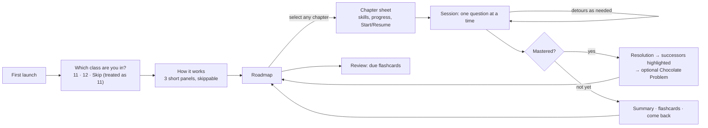

# 02 · Student journey and three complete learner journeys

## The overall journey



- **No account, no sign-in.** Everything is stored in this browser. Settings offers *Export my progress*, *Import* and *Erase everything*.
- **Class** is asked once, stored locally and changeable in Settings. It is used for one thing only: never routing a Class 11 student forward into Class 12 content for remediation.
- **Every chapter is open.** The map highlights *Good places to start*. A Class 11 student sees chapters with no chapter prerequisites (Motion in a Straight Line, Sets, Ray Optics). A Class 12 student additionally sees their own class's entry chapters.
- **Continue** on the dashboard always resumes the exact paused frame, including mid-detour.

The engine rules referenced below are in docs/04. All thresholds are the initial values in `config/learning.config.json`.

---

## Journey 1 — Quick mastery

**Riya, Class 12, revising *Straight Lines* (Class 11 Maths).** It has 5 required skills: `sl.slope`, `sl.angle-between`, `sl.forms`, `sl.general-form`, `sl.distance`.

| # | Skill | Difficulty | What happens | Outcome | Engine decision |
|---|---|---|---|---|---|
| 1 | sl.forms (most central skill) | medium | Drags two points on `graph-plot`. The line and its point–slope equation update live. She enters the equation. | independent | Step up to hard. `sl.forms` covered. |
| 2 | sl.general-form | hard | Finds k so that kx + 3y − 6 = 0 is parallel to a given line. | independent | Stay hard. Covered. |
| 3 | sl.distance | hard | Distance between parallel lines. | independent | Covered. |
| 4 | sl.angle-between | hard | First answer omits the absolute value and gets an obtuse tan θ. Tag `angle-formula-missing-modulus`: the two lines' angle wedge flashes both angles (θ and 180° − θ) and asks which is "the" angle. Retry correct. | assisted | Not covered. Stay hard. Flashcard created for the tag. |
| 5 | sl.slope | hard | Perpendicularity with a parameter. | independent | Covered. |
| 6 | sl.angle-between | hard | Selection score +3 (uncovered) and +2 (needs review). | independent | Covered. Flag cleared. |
| 7 | sl.forms | hard | Intercept form from area condition. | independent | — |
| 8 | sl.distance | hard | Foot of perpendicular. | independent | — |
| 9 | sl.general-form | hard | Family of lines through an intersection. | independent | — |
| 10 | sl.slope | hard | Collinearity via slopes. | independent | **Mastery check:** 9/10 independent (≥ 8), 9 hard independent (≥ 2), all 5 skills covered → **mastered**. |

**What Riya sees next:**

1. A brief resolution: the last line settles and the session's progress dots fill to the chapter bar.
2. Back on the map, the *Straight Lines* node bar fills and its edges light toward successors:
   - **Conic Sections** is marked *Recommended* (its only chapter prerequisite is now mastered).
   - **Three Dimensional Geometry** is marked *Next after Vector Algebra*.
   - **Application of Integrals** is marked *Next after Integrals and Conic Sections*.
3. The **Chocolate Problem** is offered: a ray leaves (1, 2), reflects off x + y = 5 and passes through (4, −1); find the point of reflection. It is optional, gives unlimited hints and has no mastery effect.
4. One flashcard is queued (modulus in the angle formula), due tomorrow.

**Stored:** session `mastered`, 10 main records, chapter status `mastered`, skill evidence, 1 flashcard. About 20–25 minutes.

---

## Journey 2 — A friction error leads to free-body-diagram practice

**Aarav, Class 11, *Laws of Motion*.** He has done Q1–Q3: two independent and one assisted, so the difficulty is now hard.

**Q4 (main, hard, `lom.friction`)** uses the template in `content/templates/lom/lom.friction/`:

> A 4 kg block rests on a plank tilted at 30°. μs = 0.65. What is the friction force?

The correct answer is mg sin θ = 19.6 N.

| Attempt | Aarav answers | Checker (buggy-solver match) | Feedback he sees |
|---|---|---|---|
| 1 | 25.5 N (μs·mg) | `normal-equals-weight` and `static-friction-always-max` | The weight arrow splits into components along and perpendicular to the plank. The normal arrow shrinks from mg to mg cos θ. Text: "On an incline the plank pushes back only against the part of the weight pressing into it." |
| 2 | 22.1 N (μs·mg cos θ) | `static-friction-always-max` | A friction meter fills to show how much friction is *needed* (19.6 N) against how much is *available* (22.1 N). He opens Help level 1. |
| 3 | 34.0 N (mg cos θ) | `sin-cos-swap-incline` | The angle between the weight and the plank's normal is highlighted as θ. |

The question is **exhausted**. The engine records it with three tags, creates three flashcards and flags `lom.friction` as needing review.

**Easy diagnostic (remediation, `lom.friction`, easy):**

> Draw every force on a block resting on this incline.

Aarav sets N equal to the weight and adds an arrow "pushing it down the slope". The diagram rules fire `normal-equals-weight` and `extra-force-of-motion`. The diagnostic is not independent, so the engine plans a detour.

**Detour planner:**

- Closure: ancestors of `lom.friction`, excluding Class 12 and anything already on the stack.
- Tagged candidates:
  - `lom.resolve-forces`: 3 supporting tags, distance 1
  - `lom.fbd`: 3 supporting tags, distance 2
  - `mip.resolution` and `f.trig-ratios`: 1 tag each
- Nearest wins the tie: **probe `lom.resolve-forces`** (easy: "drag the two components of a 20 N weight on a 30° slope"). He gets it on a retry, so not independent.
- **Push depth 1** (`lom.resolve-forces`).

**Detour, depth 1 — `lom.resolve-forces`:**

The transition is described in docs/07: the friction card docks into the breadcrumb as *Paused*, and the frame takes a peach "Detour" edge.

1. A 30-second interactive explainer: rotate the axes to align with the slope and watch the components re-project.
2. D1 (easy): independent.
3. D2 (medium): a block pushed up an incline. He again adds a "force of motion" → exhausted.
4. Easy diagnostic on `resolve-forces`: `extra-force-of-motion` again → planner → candidate **`lom.fbd`**.
5. Probe "box sliding after the push ends": he keeps the push arrow → not independent.
6. **Push depth 2** (`lom.fbd`).

**Detour, depth 2 — `lom.fbd`:**

1. Explainer "every arrow needs an agent". When he drags an arrow onto the box, the board asks "What is pushing or pulling?" Arrows with no agent fade and are labelled *no agent*.
2. Three questions:
   - box sliding on the floor: independent
   - lamp hanging from two strings: assisted
   - block resting on an incline: independent
3. Mini-mastery is met (2 of 3 independent, last one independent).
4. **Pop to depth 1.**

**Return to depth 1:**

1. The suspended D2 card re-expands. Its worked solution replays as a scrubbable sequence.
2. Return question (fresh variant): independent.
3. D3: independent. Mini-mastery is met.
4. **Pop to the main frame.**

**Return to main:**

1. Q4's worked solution replays: decompose the weight, net force along the plank is zero, the friction meter shows needed vs available.
2. **Return question:** a fresh variant of the same template at hard (5.5 kg, 25°, μs 0.55). Independent. This is recorded as learning progress, not a main question.
3. Q5 continues at **medium** (step down after an exhausted main question, floor medium).

**Rest of the session:** Q5–Q12. `lom.friction` and `lom.connected-bodies` are re-covered by selection. At Q12 the last 10 main questions hold 8 independent (2 of them hard), and all 9 skills are covered → **mastered**.

The session took 12 main questions plus 13 remediation items. The deepest detour level was 2 of the 4 allowed. Flashcards queued:

- `normal-equals-weight`
- `static-friction-always-max`
- `sin-cos-swap-incline`
- `extra-force-of-motion`

**Stack at its deepest point (persisted in IndexedDB):**

```jsonc
[
  { "frameId": "f0", "mode": "main",   "depth": 0, "suspended": { "templateId": "lom.friction.h.incline-will-it-slide@1", "seedIndex": 4, "phase": "awaitingReturn" } },
  { "frameId": "f1", "mode": "detour", "depth": 1, "skillId": "lom.resolve-forces", "suspended": { "templateId": "lom.resolve-forces.m.pushed-up-incline@1", "phase": "awaitingReturn" } },
  { "frameId": "f2", "mode": "detour", "depth": 2, "skillId": "lom.fbd", "items": [ { "outcome": "independent" } ] }
]
```

If Aarav had closed the tab at any point, *Continue* would reopen `lom.fbd` with the same question and seed, and the breadcrumb would read *Laws of Motion › Friction › Resolving forces › Free-body diagrams*.

---

## Journey 3 — A foundational gap, revisited later

**Kabir, Class 11, *Motion in a Plane*.**

**Q1 (medium, `mip.vector-addition`):** independent → hard.

**Q2 (main, hard, `mip.resolution`):**

> A 50 N force acts at 37° above +x (take sin 37° = 0.6). Find its x- and y-components.

The answer is (40 N, 30 N).

| Attempt | Kabir answers | Tags | Feedback |
|---|---|---|---|
| 1 | (30, 40) | `sin-cos-swap` | The two component arrows grow from the vector's tail. The side *next to* the 37° angle is highlighted as the x-component. |
| 2 | (37.5, 30), using tan | `tan-for-component` | The board shows that tan relates the two components to each other, not to the 50 N vector. |
| 3 | (30, 40) | `sin-cos-swap` | — |

The question is **exhausted**. The easy diagnostic (vector at 30° with a drawn right triangle: "which side is adjacent to the angle?") is answered wrong with tag `opposite-adjacent-confusion`, which implicates `f.trig-ratios`.

**Planner:**

- `f.trig-ratios` is a direct prerequisite of `mip.resolution` and supported by 3 tags.
- The related link to Vector Algebra is never a route for a Class 11 student: it is Class 12 and only a soft link.
- Probe `f.trig-ratios` (easy) → wrong → **push depth 1, foundation mode**.

**Foundation micro-lesson — *Trigonometric ratios in a right triangle* (`triangle-explorer`):**

1. Kabir drags the angle marker between the two acute angles. The labels *opposite* and *adjacent* swap as the angle moves, which is the key insight. Live bars show sin, cos and tan.
2. A scrubbable 4-step explanation follows.
3. Practice: 1 of 3 independent.
4. The engine repeats the micro-lesson once with an alternate representation: a vector's "shadows" on the axes as a lamp moves overhead.
5. Practice again: 1 of 3 independent → **Stuck**.

**What Kabir sees:**

> **Your next step:** Trigonometric ratios in a right triangle (about 6 minutes).
> We saved your place in *Motion in a Plane › Resolving vectors*.
>
> [Try again now] [Back to the question anyway] [Pause for today]

He chooses **Pause for today**. Stored:

- session `paused`, with the stack shown in docs/04;
- recommendation `{kind: "foundation-gap", skillId: "f.trig-ratios", returnSessionId}`;
- `gapOpen` on `mip.resolution`;
- two flashcards: *opposite vs adjacent*; *which ratio gives the x-component*.

**Two days later:**

1. The dashboard's *Continue* card reads:
   > Paused · Motion in a Plane › Resolving vectors — first: Trig ratios (about 6 min)
2. On the map, the *Motion in a Plane* node carries a paused marker and a thin dashed amber thread to a small foundation badge.
3. *Review* shows the two flashcards as due. He reviews both.
4. He taps *Continue*. The foundation frame offers a 30-second recap (scrubbable; can be skipped), then new practice: 3 of 3 independent → **pop to main**.
5. Return transition: Q2's worked solution replays, with the components projecting from the vector.
6. Return question (fresh variant, 60 N at 53°): independent. `gapOpen` is cleared and the recommendation is marked resolved.
7. Q3 continues at **medium**. Skills that depend on `mip.resolution` (velocity in a plane, projectiles, circular motion) are selectable again.

**Had he chosen *Back to the question anyway*:**

- Q2's worked solution would have shown.
- The session would have continued with skills that do not depend on `mip.resolution` (for example `mip.vector-basics`).
- The recommendation would have stayed on the dashboard.
- Mastery could not complete until `mip.resolution` was covered, because it is required.
