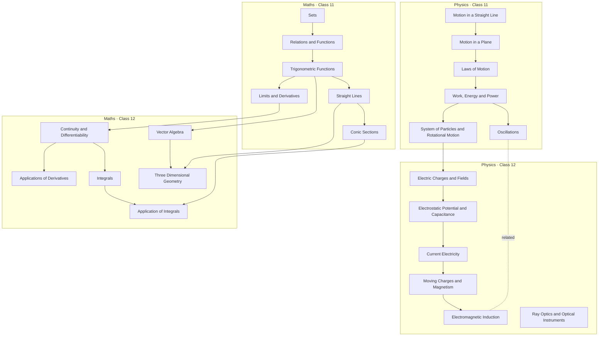

# 03 · Chapter and skill graphs

**Source of truth:** `content/curriculum/*.json`.
**Full generated tables, per-chapter skill lists and diagrams:** [`docs/generated/curriculum-graph.md`](generated/curriculum-graph.md) (rendered image: [`diagrams/chapter-graph.svg`](diagrams/chapter-graph.svg)).

Re-run after any edit:

```bash
node scripts/validate-curriculum.mjs      # validates, then regenerates the derived files; exit 1 on any violation
```

## Scope

This is a **curated 24-chapter subset** of CBSE/NCERT Class 11–12 Physics and Mathematics, not the complete syllabus (U-01).

| | Physics | Mathematics |
|---|---|---|
| **Class 11** | Motion in a Straight Line · Motion in a Plane · Laws of Motion · Work, Energy and Power · System of Particles and Rotational Motion · Oscillations | Sets · Relations and Functions · Trigonometric Functions · Straight Lines · Conic Sections · Limits and Derivatives |
| **Class 12** | Electric Charges and Fields · Electrostatic Potential and Capacitance · Current Electricity · Moving Charges and Magnetism · Electromagnetic Induction · Ray Optics and Optical Instruments | Continuity and Differentiability · Applications of Derivatives · Integrals · Application of Integrals · **Vector Algebra** · Three Dimensional Geometry |

Titles follow the NCERT textbooks with one product exception. The brief's "Vectors" is now **Vector Algebra** (U-01). The derivatives chapter is shown as **Applications of Derivatives** (U-16; NCERT uses the singular). **Application of Integrals** keeps the NCERT title.

## Three kinds of node

| Kind | Count | Shown on map | Role |
|---|---|---|---|
| **Chapter** | 24 | yes, as nodes | Contains skills. All are visible and selectable (U-02). |
| **Skill** | 146 | inside the chapter sheet and the session breadcrumb | The unit of evidence, coverage and detours. |
| **Foundation micro-skill** | 26 | as small badges, only when a gap is open | The leaves of every detour. Class 9–10 content, or Class 11 content outside the subset ("bridge"). Never Class 12. |

## Edge rules (machine-checked)

1. **Hard prerequisite edges exist only between skills** (and from skills to foundations). Chapter edges are **derived**: chapter A → chapter B exists if some skill in B requires a skill in A. The derived graph has 48 edges; the overview diagram draws the 23 that remain after transitive reduction. Each edge lists the skill edges that justify it in the generated report.
2. **Acyclic** at skill level and at derived chapter level. The validator reports the exact cycle path if one is introduced.
3. **No forward-class edges.** A Class 11 skill never requires a Class 12 skill. At runtime, the planner also never routes a Class 11 *student* into Class 12 content, even when they chose a Class 12 chapter (U-03, OQ-2).
4. **No hard Physics ↔ Maths edges.** The maths that Physics needs is taught as Physics skills (e.g. `wep.scalar-product`, `rot.vector-product`) or as foundations (`f.slope`, `f.area-graph`, `f.trig-ratios`). Cross-subject relationships are **related links** (U-04).
5. **Related links** are dotted and labelled *related*. They may join chapters in the same or different subjects, but may not duplicate a prerequisite edge between the same pair (checked). They never gate and never trigger remediation.
6. **Excluded by decision:** no `Integrals → Work, Energy and Power` relationship of any kind, and no two-way Vectors ↔ Motion in a Plane edge (U-04). The only connection there is a single undirected soft link explaining that Vector Algebra formalises the vectors met in Motion in a Plane.
7. **Every skill bottoms out in a foundation**, so every detour can end in an interactive micro-lesson.
8. **Every chapter can be mastered within 10 questions:** at most 10 required skills (the maximum today is 9, in Laws of Motion). See the coverage matrix in [`generated/coverage-matrix.md`](generated/coverage-matrix.md).

Mutation checks confirmed that the validator fails, with a specific message, for each of:

- a planted cycle;
- a forward-class edge;
- a cross-subject edge;
- a missing prerequisite;
- an Integrals–WEP link;
- a related link that duplicates a prerequisite.

## Edge review (2026-10-27, after your Phase 0 review)

| Edge | Verdict | Specific skill and reason |
|---|---|---|
| System of Particles and Rotational Motion → Electric Charges and Fields | **Kept, narrowed.** `ecf.dipole` was split into `ecf.dipole` (the dipole and its field: no rotational prerequisite) and `ecf.dipole-torque`. | `ecf.dipole-torque` → `rot.torque-equilibrium`. The torque on a dipole in a uniform field, τ = p × E (magnitude pE sin θ), is the torque of a couple. Torque and couples are taught in the Class 11 chapter *System of Particles and Rotational Motion*. A Class 12 student who cannot reason about torque has a genuine gap there, and that is where remediation should go. |
| Oscillations → Electromagnetic Induction | **Removed.** Now a labelled *related* link. | The only cause was `emi.ac-generator` → `osc.shm-displacement`. The generator's emf, NBAω sin ωt, needs the coil angle θ = ωt (`rot.angular-kinematics`) and the cosine of the flux angle (`f.trig-ratios`), not simple harmonic motion. Prerequisites are now `emi.faraday-lenz`, `rot.angular-kinematics`, `f.trig-ratios`. |
| Route into Current Electricity | **Changed.** Added Electrostatic Potential and Capacitance → Current Electricity. | `cur.emf` → `epc.potential`: emf, terminal voltage and Kirchhoff's loop rule are statements about potential difference and work per unit charge. Electric Charges and Fields → Current Electricity (`cur.drift-ohm` → `ecf.field`: drift velocity comes from the force eE on electrons) remains a true dependency, but transitive reduction hides it in the overview because it now flows through Electrostatic Potential. Work, Energy and Power → Current Electricity (`cur.power` → `wep.power`) is likewise hidden. |

## Shape of the derived chapter graph



**Reading it.**

- Ray Optics depends only on foundations (Class 10 light). It is an independent entry point.
- Electric Charges and Fields sits below rotation only because of one skill, `ecf.dipole-torque` (τ = p × E needs torque and couples, `rot.torque-equilibrium`). See the edge review below.
- The route into Current Electricity is Electric Charges and Fields → Electrostatic Potential and Capacitance → Current Electricity. Oscillations and Electromagnetic Induction are linked as *related*, not as prerequisites.

The longest skill-level chain down to a foundation is 17 steps, from `tdg.shortest-distance`. Detours never walk the whole chain: the planner follows only evidence-implicated skills, and the runtime caps depth at 4 (docs/04).

## Related links (never prerequisites, never remediation)

| | | Why it's shown |
|---|---|---|
| Limits and Derivatives | Motion in a Straight Line | instantaneous rate = velocity |
| Trigonometric Functions | Motion in a Plane | resolving vectors |
| Trigonometric Functions | Oscillations | sinusoidal displacement |
| Vector Algebra | Motion in a Plane | formalises vectors met in physics |
| Vector Algebra | Moving Charges and Magnetism | magnetic force is a vector product |
| Applications of Derivatives | Motion in a Straight Line | rates and turning points of motion |
| Oscillations | Electromagnetic Induction | an AC generator's emf is sinusoidal, like SHM (same subject, but not a prerequisite) |
| Conic Sections | Ray Optics and Optical Instruments | reflecting surfaces are conics |

## Content accuracy note

Skill lists follow NCERT topic headings and were drafted from knowledge of the rationalised (2023-onward) textbooks. During content authoring (Phase 6) each chapter's skill list must be checked against the current textbook PDFs before its templates are approved. Removed topics are deleted and missing topics added, and the validator is re-run. This is a content-workflow step, not an open product question.
