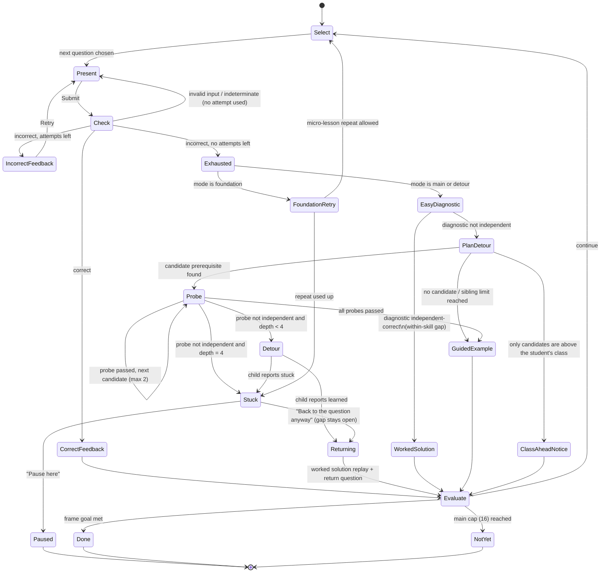

# 04 · Adaptive engine: questions, detours and mastery

**Implementation status (2026-10-28):** built in the consolidated Phase 3 as a pure, persisted session record (`src/engine/session.ts`, D-064) rather than an XState actor; the behaviour below is implemented except the Chocolate Problem and interactive guided-example steps (a worked-solution step-through is shown). Where this document and the build differ, the decision log records why (D-063–D-072). See [phase-3-report.md](phase-3-report.md).

Thresholds are read at runtime from `config/learning.config.json` through the validated reader `src/domain/config.ts`.

**Content eligibility:** the current demonstration catalog permits validated in-review templates under proposed D-053; only unchanged human-approved content may count toward mastery. References below to approved-only sessions describe the target adaptive content policy, not the current demo catalog. D-053 remains unresolved.

## Vocabulary

| Term | Meaning |
|---|---|
| **Main question** | A scored question in a chapter session. The session aims for **10** and is capped at **16**. |
| **Remediation item** | Any other question: the easy diagnostic, probes, detour questions, foundation practice and return questions. These are **additional to the 10**. They update skill evidence but never the mastery window. |
| **Attempt** | A submitted answer the checker could evaluate. Each question allows the initial answer plus **2 retries**. Unparseable input, a missing unit, or a "can't verify, rewrite it" result is **not** an attempt (it gets inline guidance instead). |
| **Independent correct** | Correct on the **first attempt with no hint, tutor or worked-solution use** on that question. This is the only outcome that counts toward mastery. |
| **Assisted correct** | Correct on a retry, or after opening any hint or tutor. Counts as **learning progress**, not mastery. |
| **Exhausted** | Three incorrect attempts. |
| **Evidence** | Per skill: the list of outcomes, with difficulty, hint level and misconception tags. |
| **Frame** | One level of the practice stack: the main session, a detour or a foundation lesson. |

## Practice loop (shared by main, detour and foundation frames)

One XState machine, `practiceLoop`, runs every frame. A detour is a **child actor of the same machine** with `mode: "detour"` and a single target skill. Foundations use `mode: "foundation"`, which opens with a micro-lesson. Recursion is therefore structural, bounded by the depth guard and cycle guard below.



`Evaluate` checks the frame goal:

| Mode | Goal |
|---|---|
| main | chapter mastery rule (below) |
| detour | mini-mastery: 3 questions with ≥ 2 independent correct and the last one independent, max 6 questions |
| foundation | 2 of 3 practice questions independent, max one micro-lesson repeat per visit |

### Transition table (events, guards, effects)

| From | Event | Guard | To | Effects (all persisted before the UI updates) |
|---|---|---|---|---|
| Select | — | — | Present | Choose skill, difficulty and template (see *Selection*). Sample parameters with seed `hash(sessionSeed, frameId, index)`. |
| Present | `SUBMIT` | checker returns `invalid` or `indeterminate` | Present | Inline message ("Add a unit", "Give an exact value", "Write it another way"). Attempt count unchanged. |
| Present | `SUBMIT` | correct | CorrectFeedback | Record outcome (independent if attempt 1 and no help used). |
| Present | `SUBMIT` | incorrect and attempt < 3 | IncorrectFeedback | Detect misconception tags. Play the consequence visual. Offer Help. |
| Present | `SUBMIT` | incorrect and attempt = 3 | Exhausted | Record `exhausted` with all tags. Create flashcards for tags. Flag the skill `needsReview`. |
| Present | `OPEN_HINT(k)` / `OPEN_TUTOR` | — | Present | Mark the question assisted. Log the hint level. |
| Exhausted | — | mode ≠ foundation | EasyDiagnostic | Pick an `easy` approved template for the **same skill**, not seen this session. |
| EasyDiagnostic | outcome | independent | WorkedSolution | Classify as a within-skill difficulty gap. Replay the worked solution of the original question. Set next main difficulty one step down. |
| EasyDiagnostic | outcome | not independent | PlanDetour | Merge tags from the original question and the diagnostic. |
| PlanDetour | — | see *Detour planner* | Probe / GuidedExample / ClassAheadNotice | — |
| Probe | outcome | independent and candidates remain and probes < 2 | Probe | Try the next candidate. |
| Probe | outcome | not independent and depth < 4 | Detour | **Push frame** `{skill: candidate, depth+1, suspended: original question state}`. |
| Detour | `child.done(learned)` | — | Returning | **Pop frame.** Mark the prerequisite `independent`. |
| Returning | — | — | Evaluate | Worked-solution replay of the suspended question, then a **return question** (a fresh variant of the same template at the same difficulty, not a main question). |
| any | `QUIT` / tab close | — | Paused | Stack and current question state are already persisted. Nothing extra is needed. |

## Selection (main questions)

At each `Select` in a main frame:

1. **Skill score** for each chapter skill:
   - +3 if required and not yet covered (no independent correct this session)
   - +2 if `needsReview`
   - +1 if all its same-chapter prerequisites are already independent (keeps a sensible teaching order)
   - −2 if it was the skill of the previous main question
   - −∞ if a foundation gap blocking it is open
2. **Difficulty**:
   - Start at `medium`.
   - After an independent correct, step up.
   - After an assisted correct, stay.
   - After an exhausted question, the next main question steps down, with `medium` as the floor for main questions. `easy` is only used for remediation.
   - If the hard questions still needed exceed the remaining questions, force `hard` (`minHardOpportunities` = 3).
3. **Template**: approved, matching the skill and difficulty, not yet used this session. If none exists, the content build would have failed (docs/05 requires ≥ 2 approved templates per skill × difficulty before a chapter ships).

The **first question** of a session is the medium question for the chapter's most central required skill (the one with the most same-chapter dependents), so it doubles as placement.

## Mastery rule (initial values)

A chapter is **mastered** when all of these hold after a main question:

1. At least **10** main questions have been answered (so the window is full).
2. In the **last 10** main questions, at least **8** were independent correct.
3. Of those, at least **2** were `hard`.
4. **Coverage:** every `required` skill has at least one independent-correct main answer **this session**. The validator checks that each chapter has ≤ 10 required skills (the maximum today is 9), so a perfect run can always cover every skill.
5. No AI-graded item contributed. Written reasoning never counts (`aiGradedItemsCount: false`).

### Coverage: can every required skill be assessed inside the last-10 window?

Yes, for all 24 chapters. The validator generates a chapter-by-chapter matrix, [`generated/coverage-matrix.md`](generated/coverage-matrix.md), from the curriculum and this config. It fails the build if any chapter breaks the rule. Summary:

| Required skills in chapter | Chapters | Free slots in a perfect 10-question run | Misses tolerated with mastery still at Q10 | Max misses with mastery still reachable by Q16 (best case) |
|---|---|---|---|---|
| 9 | Laws of Motion | 1 | 1 | 7 |
| 8 | Work, Energy and Power · Electric Charges and Fields · Continuity and Differentiability · Integrals | 2 | 2 | 8 |
| 7 | Motion in a Straight Line · System of Particles and Rotational Motion · Electrostatic Potential and Capacitance | 3 | 2 | 8 |
| 6 | Motion in a Plane · Oscillations · Sets · Trigonometric Functions · Current Electricity · Moving Charges and Magnetism · Ray Optics and Optical Instruments | 4 | 2 | 8 |
| 5 | Relations and Functions · Straight Lines · Conic Sections · Limits and Derivatives · Electromagnetic Induction · Applications of Derivatives · Vector Algebra | 5 | 2 | 8 |
| 3–4 | Application of Integrals (3) · Three Dimensional Geometry (4) | 6–7 | 2 | 8 |

**Why it works:**

- Selection gives every uncovered required skill +3 priority, so in a perfect run each required skill gets a slot within the first 10 questions. The generated matrix lists the exact order per chapter.
- A perfect run is medium at Q1, then hard from Q2. That gives 9 hard independent answers against the 2 needed.
- With *k* misses (non-independent main answers), the earliest mastery is at question max(10, max(8, R) + k), where *R* is the number of required skills. In the best case the misses come early and drop out of the window.

### What happens at the 16-question cap

If question 16 is answered and the rule is still not met, the session ends as **Not yet**. Nothing is lost and nothing is locked:

1. **The student sees a short summary:**
   - which skills are solid (independent this session);
   - which need more practice (assisted or exhausted);
   - which required skills were not yet covered.

   Buttons: *Review cards*, *Start a fresh session*, *Back to map*.
2. **Saved:**
   - all skill evidence, misconception tags and flashcards;
   - any open foundation-gap recommendation;
   - the session record with status `notYet`.
3. **On the map:** the chapter shows *Needs review* if any skill ended exhausted or has due flashcards; otherwise it shows *Learning*. It is never hidden, locked or reset.
4. **The next session** starts a **fresh window and fresh coverage set**, so mastery always reflects recent, unaided work. Selection begins with the skills that were weakest or uncovered last time, at medium. Remediation counts are unaffected: detours and foundation lessons never use main-question slots.
5. **Why 16:** it bounds a session to about 30–40 minutes, while leaving room for up to 6 early misses to leave the window on top of the misses the window tolerates. Like every number here, it is configurable (`session.mainQuestionCap`).

### Skill states

| State | Rule |
|---|---|
| `unseen` | no evidence |
| `practising` | some evidence |
| `independent` | ≥ 2 independent correct at medium or above in the last 4 attempts, or detour mini-mastery achieved |
| Flags | `needsReview` (an exhausted or assisted outcome since the last independent one); `gapOpen` (a foundation or prerequisite recommendation is unresolved) |

## Detour planner

The input is skill **S**, the misconception tags **T** from the exhausted question plus the easy diagnostic, the current stack, and the student's class.

1. **Closure.**
   - Start from `ancestors(S)` in the skill graph.
   - Remove skills already on the stack (cycle guard).
   - Remove skills that already had a detour under this suspended question (at most 2 sibling detours).
   - Remove skills whose chapter class is above the student's class (forward guard, U-03).
2. **Tagged candidates.** Each misconception tag lists the skills it `implicates` (docs/05). Candidates are `implicates(T) ∩ closure`, ordered by:
   - number of supporting tags (descending)
   - then graph distance from S (nearest first)
   - then weakest existing evidence
3. **Fallback.** If there are no tagged candidates, use S's **direct** prerequisites in the closure that lack `independent` evidence, weakest first.
4. **Class-ahead case.** If candidates exist only above the student's class (a Class 11 student who chose a Class 12 chapter), show **ClassAheadNotice** instead of routing (see OQ-2):
   > "This question builds on *Chain rule* from *Continuity and Differentiability* (Class 12). You can open that chapter from the map whenever you like."

   Then show the worked solution and continue.
5. **Probe** up to 2 candidates with an `easy` question each:
   - The first probe that is not independent becomes the detour target.
   - If every probe passes, there is no prerequisite gap. Show a **guided example**: a step-through of the original problem where the student completes each step with the widget. Then continue.
6. **Depth guard.**
   - The main frame is depth 0.
   - A detour may be entered at depths 1–4.
   - At depth 4, a failed probe or a failed mini-mastery goes to **Stuck** instead of a fifth level.

**Foundation leaves.** If the target is a foundation micro-skill, the frame runs in `foundation` mode:

1. Interactive micro-lesson (scrubbable, widget-driven).
2. Three practice questions; two independent needed.
3. If missed, one repeat of the micro-lesson with an alternate representation, then practice again.
4. If still missed, go to **Stuck**.

### Stuck: recommend and preserve the return point

The student sees what to learn next and why. It is saved to the dashboard as a recommendation card. The student chooses one of:

- **Back to the question anyway** — pop to the suspended question. `gapOpen` stays set, and selection avoids skills blocked by the gap.
- **Pause here** — the session is suspended with the full stack. *Continue* on the dashboard resumes at this exact frame.
- **Try the lesson again** — allowed once more per visit.

## The persisted stack

Each practice-loop transition writes the session record before the UI updates.

```jsonc
// IndexedDB table: sessions
{
  "id": "ses_7f3a",                       // random, local only
  "chapterId": "mip",
  "status": "paused",                     // active | paused | mastered | notYet
  "seed": 2918331,
  "startedAt": "2026-10-27T10:02:11Z",
  "main": [ { "i": 1, "templateId": "mip.vector-addition.m.03@2", "seedIndex": 1, "difficulty": "medium", "outcome": "independent" },
            { "i": 2, "templateId": "mip.resolution.h.01@1", "seedIndex": 2, "difficulty": "hard", "outcome": "exhausted", "tags": ["sin-cos-swap", "tan-for-component"] } ],
  "stack": [
    { "frameId": "f0", "mode": "main", "depth": 0, "skillId": null,
      "suspended": { "templateId": "mip.resolution.h.01@1", "seedIndex": 2, "attempts": ["30, 40", "37.7, 30", "30, 40"], "hintsUsed": 0, "phase": "awaitingReturn" },
      "siblingDetours": ["f.trig-ratios"] },
    { "frameId": "f1", "mode": "foundation", "depth": 1, "skillId": "f.trig-ratios",
      "lessonRepeatsUsed": 1, "items": [ { "outcome": "independent" }, { "outcome": "exhausted" }, { "outcome": "assisted" } ],
      "state": "stuck" }
  ],
  "contentVersion": "2026.11.0"
}
```

When the app loads:

- A session with a non-empty stack restores the top frame. A frame persisted in `Present` restores the same question **with the same seed**, so the numbers do not change.
- If the content version has changed and the suspended template was retired, the engine substitutes another template of the same skill and difficulty and says so in one line.

## Flashcards, successors, Chocolate Problem

- **Flashcards.**
  - Created when a question is exhausted or a misconception tag fires.
  - One card per tag. The front is the concept question; the back is the key idea with a small widget snapshot. Cards are authored with the misconception, not generated by AI.
  - Duplicates merge.
  - Scheduled with Leitner boxes at 1/2/4/8/16-day intervals.
- **Successor recommendation** after mastery of chapter C:
  - Candidates are chapters with a derived edge C → X.
  - Ranked by the share of X's prerequisite chapters already mastered, then same subject, then the student's class.
  - The top 1–2 are highlighted as *Recommended*. Others are labelled *Next after …*.
  - Nothing is ever locked (U-02).
- **Chocolate Problem.** One optional multi-skill problem per chapter, offered after mastery.
  - Unlimited attempts and full hints.
  - Never affects mastery.
  - Solving it adds a small mark to the chapter node.

## What the engine never does

- Route a student into a chapter above their class.
- Count a hinted, retried, remediation or AI-graded answer toward mastery.
- Hide or lock a chapter.
- Show a template that is not `approved`. The engine asserts this at load and in tests (docs/05).
- Lose a suspended question, including across reloads and app updates.
