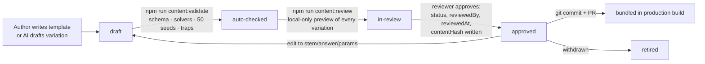

# 05 · Content schema, widgets, answer checking and verification

## 1. Question template schema

Content is authored as JSON files in `content/templates/<chapter>/<skill>/<id>.json`. One template produces many variations through parameters. A complete worked example lives at `content/templates/lom/lom.friction/lom.friction.h.incline-will-it-slide.json`; the misconception catalogue it references is `content/misconceptions/lom.json`.

> **As built in Phase 2.** The Zod schema is `src/content/schema.ts` and it is the source of truth; the sketch below is the Phase 0 design. Differences (D-057): formats are `single-choice`, `multi-choice`, `quantity`, `number`, `expression`, `antiderivative`, `equation`, `interval`, `set`, `ordering`, `mapping` and `diagram`, and written reasoning is an optional part of any template (never its scored part); hints are exactly 3; cues are `{ cue, args }` (or lists of them) whose names each widget declares; `consequence` and `resolution` cue lists play a wrong answer's consequence and, once the question ends, the correct state; cue arguments may use the runtime tokens `$value`, `$tags`, `$input` and `$details.*`; `variants` swap stems, hints and solutions by a parameter; constraints and `{{placeholders}}` are evaluated by our own safe parser (D-048), not mathjs; text fields always stay text. `npm run content:validate` enforces every rule listed in §3.3.

```ts
type Difficulty = "easy" | "medium" | "hard";
type Status = "draft" | "auto-checked" | "in-review" | "approved" | "retired";

interface QuestionTemplate {
  id: string;                         // "<skill>.<e|m|h>.<slug>"
  version: number;                    // bump on any change to stem, answer, parameters or solver
  status: Status;                     // only "approved" is bundled or counted
  provenance: {
    origin: "human" | "ai-draft";
    author: string;
    model?: string;                   // ai-draft only: model id
    promptRef?: string;               // ai-draft only: drafting prompt file and hash
    createdAt: string;
    reviewedBy: string | null;        // a developer/content reviewer, recorded in git
    reviewedAt: string | null;
    contentHash: string | null;       // sha256 of the canonical JSON when approved
  };
  chapterId: string;
  skillIds: string[];                 // every skill exercised
  primarySkillId: string;             // the skill whose evidence this updates
  difficulty: Difficulty;
  format: "choice" | "multi-choice" | "numeric" | "expression" | "interval" | "set"
        | "equation" | "ordering" | "drag-drop" | "diagram" | "reasoning";
  estimatedSeconds: number;
  parameters: Record<string, ParamSpec>;  // int | decimal | choice | const, with ranges/steps/units
  constraints: string[];              // parameter-only predicates, evaluated by mathjs; resampled until all hold (max 200 tries, else build error)
  stem: RichText;                     // Markdown + KaTeX, with {{param}} and {{derived}} substitution
  widget?: WidgetUse;                 // type + mode ("explore" | "answer") + config (may reference params)
  answer: AnswerSpec;                 // see section 3
  misconceptionRules: Array<{ tags: string[]; match: MisconceptionMatch }>;
  hints: Array<{ level: 1 | 2 | 3; text: RichText; cue?: CueRef }>;   // 2–3 levels; level 3 may approach but never state the final answer
  feedback: Record<string /*tag*/ | "generic", { text: RichText; cue?: CueRef }>;
  workedSolution: Array<{ text: RichText; cue?: CueRef; widgetState?: unknown }>;
  visualExplanation: { widget: string; timeline: CueRef[] };          // scrubbable
  reasoning?: { prompt: RichText; rubric: string[] };                 // optional; AI-advisory only, never scored
  accessibility: { altText: RichText; nonDragAlternative?: string };  // required whenever any input is a drag
}

type MisconceptionMatch =
  | { buggySolver: string }           // a registered "wrong method" function; numeric match within tolerance
  | { optionId: string }              // a distractor option
  | { dimensionNot: string }          // answer has the wrong physical dimension
  | { expressionEquivalentTo: string }// e.g. derivative with the chain rule omitted
  | { diagramRule: string };          // e.g. "extraForceWithoutAgent"
```

**Solvers are code, not text.** Every template names a reference solver registered in `src/content/solvers/<chapter>.ts`:

- a pure function from parameters to the exact answer, plus derived values used in hints and solutions;
- optional *buggy solvers* that reproduce common wrong methods;
- each one with its own unit tests.

AI never supplies an answer value.

**Misconception catalogue** (`content/misconceptions/<chapter>.json`). Each tag has:

- a description;
- `implicates` — the skills whose weakness the tag is evidence of. The detour planner uses this list;
- a visual cue;
- exactly one flashcard.

## 2. Widget library

A widget is a **pure model** plus a view. The Phase 0 sketch is below; the built contract (`src/widgets/types.ts`) is `WidgetModel { type, interactive, dragInputs, configSchema, cues, init, reduce, timeline, describe, answer? }`. Time is not a separate `step`: every model's state at time *t* is an exact function of *t*, so the shared transport (`src/widgets/transport.ts`) can play, pause, step between keyframes, scrub, replay and reset deterministically. Each cue has a Zod argument schema, so content validation checks every cue a template uses.

```ts
interface WidgetDefinition<Config, State, Derived> {
  type: string;
  configSchema: ZodType<Config>;
  init(config: Config, params: Params): State;
  reduce(state: State, action: WidgetAction): State;      // pure, deterministic
  derive(state: State): Derived;                          // resultant, readouts, trajectories…
  step?(state: State, dt: number): State;                 // simulations: fixed dt (1/120 s), deterministic → scrubbable
  describe(state: State, d: Derived): string;             // text for the live region and the static alternative
  extractAnswer?(state: State): AnswerPayload;            // for format "diagram"
  cues: Record<string, CueTimeline>;                      // named teaching animations used by hints, feedback and solutions
  controls: NonDragControlSpec;                           // keyboard and form equivalents for every drag
}
```

| Widget | Used for | Student manipulates | Phase |
|---|---|---|---|
| `vector-board` | vectors, forces, FBDs, components, dot and cross products (2D) | add, drag and rotate arrows; tilted axes; agent labels | **2** |
| `motion-track` | 1D/2D kinematics, projectiles, collisions, circular motion, power | initial conditions, launch angle, time scrubber; linked x–t and v–t graphs | **2** |
| `graph-plot` | functions, slope, tangents, area, limits, lines, conics, extrema | draggable points and handles, sliders, shading regions | **2** |
| `number-line` | positions, intervals, unions, inequalities | drag endpoints, toggle open/closed ends | **2** |
| `unit-circle` | radians, trig functions, allied and compound angles, trig limits | drag angle; linked sine/cosine graphs | 6 |
| `venn` | sets, operations, complements | select and shade regions; drag elements | 6 |
| `ray-diagram` | mirrors, lenses, refraction, TIR, prisms, instruments | drag object, focal points, lens and surface; principal rays | 6 |
| `circuit-board` | Ohm, Kirchhoff, Wheatstone, cells, capacitors | place components on a grid; meters; loop tracing | 6 |
| `field-map` | charges, field lines, flux, equipotentials, magnetic fields, induction | drag charges, wires and surfaces; probe | 6 |
| `oscillator` | SHM, springs, pendulums, energy | drag amplitude and phase; phasor view | 6 |
| `rigid-body` | torque, moment of inertia, rotation, AC generator coil | apply forces at points; spin; pivot | 6 |
| `space-3d` | lines in space, direction cosines, cross product | orbit view by drag or keys; drag direction vector | 6 |
| `triangle-explorer`, `mapping-diagram`, `balance-scale`, `algebra-tiles`, `unit-converter` | foundation micro-lessons and relations | drag vertices, arrows, tiles | 3–6 as foundations require |

**Accuracy is tested against physics and mathematics, not screenshots.** Each model has unit tests against analytic results. Examples:

- projectile range and apex;
- SHM period and energy drift under 0.1% over 10 periods (semi-implicit Euler or velocity Verlet);
- thin-lens and mirror equations matching ray-intersection geometry;
- circuit solver (modified nodal analysis) matching hand-solved networks;
- field superposition matching Coulomb's law;
- tangent slope matching the symbolic derivative.

## 3. Answer checking

All checkers are pure functions in `src/checking/` (dispatcher `check.ts`) and return:

```ts
type CheckResult =
  | { status: "correct"; notes?: string[] }                 // notes, e.g. "remember + C"
  | { status: "incorrect"; tags: string[] }                 // tags from misconceptionRules
  | { status: "invalid"; reason: "unparseable" | "missing-unit" | "not-exact" | "too-long" | "wrong-form" }
  | { status: "indeterminate"; reason: string };            // could not decide safely
```

Only `correct` and `incorrect` use up an attempt (config: `invalidInputConsumesAttempt: false`). An `indeterminate` result asks the student to write the answer another way, and is logged so the content team can review the case.

| Kind | Canonical form | Equivalence rule | Defaults |
|---|---|---|---|
| `choice` / `multi-choice` | option ids; order shuffled by seed | set equality | Distractors map to tags. |
| `quantity` (physics numeric) | our unit system's value converted to the SI canonical unit (D-048) | relative error ≤ `tolerance.relative` (or absolute when the expected value is 0) | 1% relative. Unit required. A wrong dimension is `incorrect` with the `dimension-mismatch` tag. A missing unit is `invalid` (no attempt used). Significant figures are not graded in v1. Sign matters (optics sign convention). |
| `number` (maths numeric) | exact rational or algebraic value | exact when the author sets `exact: true`; otherwise relative error ≤ 1e-9 | A decimal for an exact-required answer is `invalid: not-exact`. |
| `expression` | our safe AST (D-048) | **Multi-point sampling** (D-052): evaluate both at 24 seeded points in the author-declared domain; require ≥ 10 valid points; equivalent ≤ 1e-8 relative, different > 1e-5, otherwise `indeterminate`. A student expression undefined where the reference is defined is different; `specialPoints` and `domainMustMatch` catch removable discontinuities. | Variables are restricted to the declared set. Domain is required, e.g. x > 0 for logs. |
| `antiderivative` | expression | **Derivative of student answer ≡ integrand** by sampling, *or* (student − reference) constant across samples | Missing `+ C` is `correct` with a note. Configurable per template (`requireConstant`). |
| `form` requirements | AST inspection | "factorised", "simplified", "no negative exponents", "rationalised denominator" | Failing a required form is `invalid: wrong-form` with guidance. |
| `equation` (lines, conics, planes) | `F(x,y)=0` | equivalent up to a non-zero constant multiple: the coefficient vectors are proportional (exact), or each equation is satisfied at ≥ 8 sampled points of the other | Rejects `0 = 0` and other trivial forms. |
| `interval` | sorted union of intervals with exact or symbolic endpoints and open/closed flags | normalise (merge touching or overlapping pieces, drop empties), then compare endpoints (tolerance 1e-9) and closure flags exactly | Accepts `(-∞, 2] ∪ (3, 5)`, plain-text `(-inf,2] U (3,5)` and number-line widget state. |
| `set` | roster of canonical elements (numbers, ordered pairs, symbols) | set equality; order and duplicates ignored | Set-builder notation is not accepted as an answer (it is undecidable in general). The UI offers roster entry or Venn selection. |
| `ordering` | sequence of item ids | exact, or satisfies the author's partial-order constraints | — |
| `mapping` (drag-and-drop) | mapping of item to target | equals any accepted mapping | — |
| `diagram` | widget `extractAnswer()` (e.g. list of forces with agent, direction, magnitude) | rule set: required elements present (angle ±5°, magnitude ±5% relative), no forbidden elements, and the net result matches | Each failed rule maps to a tag (e.g. `extraForceWithoutAgent` → `extra-force-of-motion`). |
| `reasoning` | free text ≤ 4,000 chars | **Self-checked against the template's rubric** (D-058); stored on the device with `scored: false`. Never part of mastery, and no AI reads it. Templates that include reasoning always pair it with an auto-checked part, and only that part is scored. | — |

### Validation boundaries

- **Input limits:** 500 characters, 300 tokens, 400 AST nodes, depth ≤ 40 and 30-digit numbers per expression. Allowed functions can be restricted per template (`allowedFunctions`). Variables are limited to those declared. Ambiguous input such as `1/2x` is `indeterminate` and asks the student to add brackets.
- **Time budget:** 300 ms per check in the worker (D-050). If exceeded, the worker is restarted and the result is `indeterminate`.
- **No code execution:** parsing produces data (our own AST). There is no `eval` and no `Function`.
- **Domains are mandatory** for expression answers whose functions have restricted domains. The content validator rejects a template that omits one.
- **Known traps** (each has a regression test):
  - √(x²) vs x
  - log(x²) vs 2 log x
  - sin²x + cos²x vs 1
  - |x|/x vs sgn x
  - (x² − 1)/(x − 1) vs x + 1 (differ at x = 1)
  - tan x near π/2
  - 1e-12 vs 0
  - km/h vs m/s
  - °C differences vs K
  - `[1,2) ∪ [2,3]` vs `[1,3]`
  - `{1, 2, 2}` vs `{2, 1}`
  - 2x + 4y − 6 = 0 vs x + 2y = 3

### Tests required before any checker ships

1. **Table tests** for every row above: equivalent pairs, non-equivalent pairs, invalid inputs and the traps list.
2. **Property tests** (fast-check):
   - parse → print → parse round-trips;
   - sampling equivalence is symmetric;
   - `x` vs `x·(1+ε)` is rejected for ε > tolerance;
   - unit conversions round-trip.
3. **Template self-tests** (run by `content:validate` for **every** template and **50 seeds**; implemented in `src/content/validate.ts`, which also checks cue names and arguments against each widget, widget config, worked-solution and hint cues, determinism per seed, and development language in student text):
   - the solver's answer passes the template's own checker;
   - every buggy solver's answer fails and produces the declared tags;
   - every distractor fails;
   - all constraints are satisfiable;
   - the solver output is finite and within author-declared sane ranges;
   - no `{{placeholder}}` is left unrendered;
   - every tag exists in the catalogue;
   - hint ladders have 2–3 levels and level 1–2 hints never contain the final numeric answer;
   - the worked solution and visual explanation exist;
   - widget config validates;
   - `nonDragAlternative` is present when any input is a drag.
4. **Golden seeds:** for each numeric template, 3 seeds with hand-verified expected answers are committed in the template's test file and reviewed by a human.

## 4. Content verification workflow (offline, developer-run)

There is no reviewer role in the app (U-11). Verification happens in the repository.



**AI drafting** — `npm --prefix tools/content-drafting run draft -- --template <id> --count 5` (separate adult-only package, docs/09):

- Runs **on the developer's machine** and calls Gemini with a key from the developer's own shell environment, never the app's.
- Asks only for *new contexts, stems, distractor ideas and hint wording* for an existing human-authored template and solver.
- Writes results to `content/drafts/`, marked `origin: ai-draft` with the model id and prompt hash.
- Drafts never contain answer values. Answers always come from the solver.

**Gates:**

- *As built in Phase 2 (D-053, awaiting your approval):* `next build` runs `content:validate` first, which writes the student manifest `src/content/generated/templates.json`. It contains only templates that pass validation and are `in-review` or `approved`. An attempt counts toward mastery only when its template is `approved` and its stored `contentHash` still matches its content; an approved template edited after review fails validation, and therefore the build, until it is re-reviewed. Unit tests assert that drafts never ship and that nothing in-review counts.
- `content:review` (D-054) is a local tool, not an app route; it never ships. Approval needs a named reviewer, every variation ticked, an attestation and the session code shown in the terminal.
- `content/drafts/` is excluded from production builds.

**Lessons (Phase 3, D-068):** micro-lessons and detour explainers live in `content/lessons/<skill>.lesson.json`. They are validated by `content:validate` (schema, widget cues, development language, an alternate representation for every micro-lesson) and reviewed in `content:review` at `/l/<id>`, with the same named-reviewer gate as templates.

**Ship rule for a chapter:** every skill has at least 2 approved templates at each difficulty that the selection rules can request (easy for remediation; medium and hard for main questions), plus a micro-lesson for each foundation the chapter's closure reaches. One Chocolate Problem is optional.
