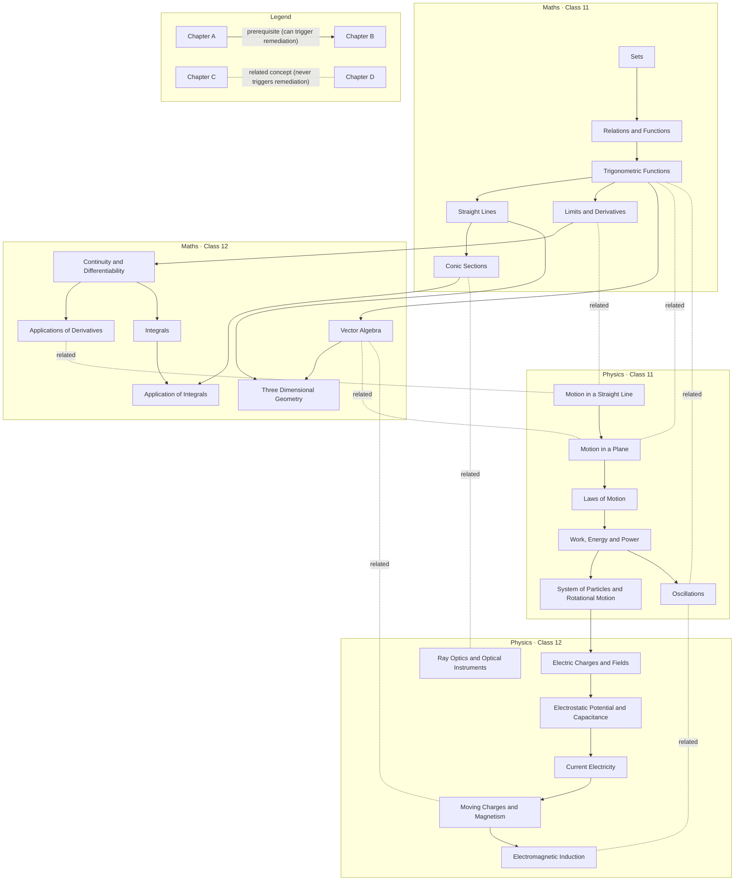

# Curriculum graph (generated)

> GENERATED by `node scripts/validate-curriculum.mjs` from `content/curriculum/*.json`. Edit the JSON, not this file.

**24 chapters · 146 skills · 26 foundation micro-skills · 268 prerequisite edges.** Longest prerequisite chain from a chapter skill down to a foundation: 17 steps (runtime detours are capped at 4 levels; see docs/04).

Checks passed: every reference resolves; no cycles (skill or chapter level); no prerequisite in a later class; no hard Physics↔Maths edges; every skill bottoms out in a foundation micro-skill.

## Chapter graph

Solid arrows are derived from skill prerequisites (transitively reduced for display). Dotted lines labelled "related" are related-concept links: they never gate and never trigger remediation.

### Why each chapter edge exists

| From | To | Because (skill edges) |
|---|---|---|
| Motion in a Straight Line | Motion in a Plane | kin.acceleration → mip.velocity-2d; kin.free-fall → mip.projectile |
| Motion in a Straight Line | Laws of Motion | kin.acceleration → lom.second-law |
| Motion in a Plane | Laws of Motion | mip.vector-addition → lom.fbd; mip.resolution → lom.resolve-forces; mip.ucm → lom.circular-dynamics |
| Motion in a Plane | Work, Energy and Power | mip.resolution → wep.scalar-product |
| Laws of Motion | Work, Energy and Power | lom.fbd → wep.work-constant; lom.momentum-conservation → wep.collisions |
| Motion in a Straight Line | Work, Energy and Power | kin.suvat → wep.ke-theorem |
| Laws of Motion | System of Particles and Rotational Motion | lom.momentum-conservation → rot.centre-of-mass; lom.fbd → rot.torque-equilibrium |
| Motion in a Plane | System of Particles and Rotational Motion | mip.resolution → rot.vector-product; mip.ucm → rot.angular-kinematics |
| Motion in a Straight Line | System of Particles and Rotational Motion | kin.suvat → rot.angular-kinematics |
| Work, Energy and Power | System of Particles and Rotational Motion | wep.energy-conservation → rot.dynamics |
| Motion in a Straight Line | Oscillations | kin.xt-graphs → osc.periodic; kin.acceleration → osc.shm-velocity-acceleration |
| Motion in a Plane | Oscillations | mip.ucm → osc.shm-displacement |
| Laws of Motion | Oscillations | lom.second-law → osc.force-law; lom.resolve-forces → osc.spring-pendulum |
| Work, Energy and Power | Oscillations | wep.energy-conservation → osc.energy |
| Sets | Relations and Functions | set.operations → rel.cartesian-product; set.intervals → rel.real-function-graphs |
| Relations and Functions | Trigonometric Functions | rel.real-function-graphs → trg.graphs |
| Trigonometric Functions | Straight Lines | trg.unit-circle → sl.slope; trg.compound-angles → sl.angle-between |
| Straight Lines | Conic Sections | sl.distance → con.locus |
| Relations and Functions | Limits and Derivatives | rel.real-function-graphs → lim.intuitive |
| Trigonometric Functions | Limits and Derivatives | trg.graphs → lim.trig |
| Motion in a Plane | Electric Charges and Fields | mip.resolution → ecf.superposition |
| Laws of Motion | Electric Charges and Fields | lom.fbd → ecf.superposition |
| System of Particles and Rotational Motion | Electric Charges and Fields | rot.torque-equilibrium → ecf.dipole-torque |
| Work, Energy and Power | Electric Charges and Fields | wep.scalar-product → ecf.flux-gauss |
| Electric Charges and Fields | Electrostatic Potential and Capacitance | ecf.field → epc.potential; ecf.superposition → epc.point-charges; ecf.gauss-applications → epc.conductors-dielectrics |
| Work, Energy and Power | Electrostatic Potential and Capacitance | wep.potential-energy → epc.potential |
| Electric Charges and Fields | Current Electricity | ecf.field → cur.drift-ohm |
| Work, Energy and Power | Current Electricity | wep.power → cur.power |
| Electrostatic Potential and Capacitance | Current Electricity | epc.potential → cur.emf |
| System of Particles and Rotational Motion | Moving Charges and Magnetism | rot.vector-product → mcm.lorentz; rot.torque-equilibrium → mcm.torque-loop |
| Laws of Motion | Moving Charges and Magnetism | lom.circular-dynamics → mcm.motion-in-field |
| Current Electricity | Moving Charges and Magnetism | cur.drift-ohm → mcm.biot-savart |
| Moving Charges and Magnetism | Electromagnetic Induction | mcm.ampere → emi.flux; mcm.lorentz → emi.motional |
| Work, Energy and Power | Electromagnetic Induction | wep.scalar-product → emi.flux |
| System of Particles and Rotational Motion | Electromagnetic Induction | rot.angular-kinematics → emi.ac-generator |
| Limits and Derivatives | Continuity and Differentiability | lim.algebra → cnd.continuity; lim.first-principles → cnd.differentiability; lim.derivative-rules → cnd.chain-rule |
| Relations and Functions | Continuity and Differentiability | rel.real-function-graphs → cnd.continuity; rel.functions → cnd.chain-rule |
| Trigonometric Functions | Continuity and Differentiability | trg.graphs → cnd.inverse-trig |
| Continuity and Differentiability | Applications of Derivatives | cnd.chain-rule → aod.rate; cnd.chain-rule → aod.monotonicity; cnd.parametric-second-order → aod.second-derivative-test |
| Sets | Applications of Derivatives | set.intervals → aod.monotonicity |
| Continuity and Differentiability | Integrals | cnd.exp-log → int.antiderivative; cnd.inverse-trig → int.antiderivative; cnd.chain-rule → int.substitution |
| Trigonometric Functions | Integrals | trg.multiple-angles → int.trig-identities |
| Integrals | Application of Integrals | int.definite-ftc → aoi.area-under-curve; int.special-forms → aoi.standard-curves |
| Conic Sections | Application of Integrals | con.circle → aoi.standard-curves; con.parabola → aoi.standard-curves; con.ellipse → aoi.standard-curves |
| Straight Lines | Application of Integrals | sl.forms → aoi.line-and-curve |
| Trigonometric Functions | Vector Algebra | trg.unit-circle → vec.dot-product |
| Vector Algebra | Three Dimensional Geometry | vec.basics → tdg.direction-cosines; vec.components → tdg.line-equation; vec.dot-product → tdg.angle-between; vec.cross-product → tdg.shortest-distance |
| Straight Lines | Three Dimensional Geometry | sl.forms → tdg.line-equation |

### Class 12 chapters: Class 12 prerequisites a Class 11 student will not be routed into

| Chapter | Class 12 prerequisite skills outside the chapter |
|---|---|
| Electric Charges and Fields | none — all prerequisites are Class 11 or foundations |
| Electrostatic Potential and Capacitance | ecf.field, ecf.superposition, ecf.gauss-applications |
| Current Electricity | ecf.field, epc.potential |
| Moving Charges and Magnetism | cur.drift-ohm |
| Electromagnetic Induction | mcm.ampere, mcm.lorentz |
| Ray Optics and Optical Instruments | none — all prerequisites are Class 11 or foundations |
| Continuity and Differentiability | none — all prerequisites are Class 11 or foundations |
| Applications of Derivatives | cnd.chain-rule, cnd.parametric-second-order |
| Integrals | cnd.exp-log, cnd.inverse-trig, cnd.chain-rule |
| Application of Integrals | int.definite-ftc, int.special-forms |
| Vector Algebra | none — all prerequisites are Class 11 or foundations |
| Three Dimensional Geometry | vec.basics, vec.components, vec.dot-product, vec.cross-product |

## Skills by chapter

### Motion in a Straight Line · Physics 11

| Skill | Prerequisites | Widget | Depth |
|---|---|---|---|
| `kin.displacement` Position, path length and displacement | *f.number-systems* | motion-track | 1 |
| `kin.avg-velocity` Average velocity and average speed | kin.displacement, *f.speed-time* | motion-track | 2 |
| `kin.xt-graphs` Position–time graphs and instantaneous velocity | kin.avg-velocity, *f.slope* | graph-plot | 3 |
| `kin.acceleration` Acceleration and velocity–time graphs (slope and area) | kin.xt-graphs, *f.area-graph* | graph-plot | 4 |
| `kin.suvat` Equations of uniformly accelerated motion | kin.acceleration, *f.rearrange*, *f.quadratic* | motion-track | 5 |
| `kin.free-fall` Free fall and vertical motion | kin.suvat | motion-track | 6 |
| `kin.relative-1d` Relative velocity in one dimension | kin.avg-velocity | motion-track | 3 |

### Motion in a Plane · Physics 11

| Skill | Prerequisites | Widget | Depth |
|---|---|---|---|
| `mip.vector-basics` Scalars, vectors and multiplication by a scalar | *f.coord* | vector-board | 2 |
| `mip.vector-addition` Adding and subtracting vectors graphically | mip.vector-basics, *f.angles* | vector-board | 3 |
| `mip.resolution` Resolving vectors into components; unit vectors | mip.vector-addition, *f.trig-ratios*, *f.pythagoras* | vector-board | 4 |
| `mip.velocity-2d` Position, velocity and acceleration in a plane | mip.resolution, **kin.acceleration** | motion-track | 5 |
| `mip.projectile` Projectile motion | mip.velocity-2d, **kin.free-fall** | motion-track | 7 |
| `mip.ucm` Uniform circular motion and centripetal acceleration | mip.velocity-2d, *f.circle* | motion-track | 6 |

### Laws of Motion · Physics 11

| Skill | Prerequisites | Widget | Depth |
|---|---|---|---|
| `lom.first-law` Inertia and Newton's first law | *f.force-intro* | vector-board | 1 |
| `lom.second-law` Momentum, Newton's second law and impulse | lom.first-law, **kin.acceleration** | motion-track | 5 |
| `lom.third-law` Newton's third law and action–reaction pairs | lom.first-law | vector-board | 2 |
| `lom.fbd` Free-body diagrams and equilibrium of a particle | lom.third-law, **mip.vector-addition** | vector-board | 4 |
| `lom.resolve-forces` Resolving forces, including on an incline | lom.fbd, **mip.resolution** | vector-board | 5 |
| `lom.friction` Static and kinetic friction | lom.resolve-forces, lom.second-law | vector-board | 6 |
| `lom.connected-bodies` Connected bodies, tension and pulleys | lom.fbd, lom.second-law | vector-board | 6 |
| `lom.momentum-conservation` Conservation of momentum | lom.second-law, lom.third-law | motion-track | 6 |
| `lom.circular-dynamics` Circular-motion dynamics: level and banked roads | lom.friction, **mip.ucm** | vector-board | 7 |

### Work, Energy and Power · Physics 11

| Skill | Prerequisites | Widget | Depth |
|---|---|---|---|
| `wep.scalar-product` Scalar (dot) product | **mip.resolution** | vector-board | 5 |
| `wep.work-constant` Work done by a constant force | wep.scalar-product, **lom.fbd**, *f.work-energy-intro* | vector-board | 6 |
| `wep.work-variable` Work by a variable force as area under an F–x graph | wep.work-constant, *f.area-graph* | graph-plot | 7 |
| `wep.ke-theorem` Kinetic energy and the work–energy theorem | wep.work-constant, **kin.suvat** | motion-track | 7 |
| `wep.potential-energy` Potential energy, conservative forces and spring energy | wep.work-variable | graph-plot | 8 |
| `wep.energy-conservation` Conservation of mechanical energy | wep.ke-theorem, wep.potential-energy | motion-track | 9 |
| `wep.power` Power | wep.work-constant | motion-track | 7 |
| `wep.collisions` Elastic and inelastic collisions | wep.energy-conservation, **lom.momentum-conservation** | motion-track | 10 |

### System of Particles and Rotational Motion · Physics 11

| Skill | Prerequisites | Widget | Depth |
|---|---|---|---|
| `rot.centre-of-mass` Centre of mass of particle systems and symmetric bodies | **lom.momentum-conservation**, *f.coord* | rigid-body | 7 |
| `rot.vector-product` Vector (cross) product and the right-hand rule | **mip.resolution** | vector-board | 5 |
| `rot.angular-kinematics` Angular velocity and angular acceleration | **mip.ucm**, **kin.suvat** | rigid-body | 7 |
| `rot.torque-equilibrium` Torque, couples and equilibrium of a rigid body | rot.vector-product, **lom.fbd** | rigid-body | 6 |
| `rot.moment-of-inertia` Moment of inertia (using standard results) | rot.centre-of-mass | rigid-body | 8 |
| `rot.dynamics` τ = Iα, rotational work and rotational kinetic energy | rot.torque-equilibrium, rot.moment-of-inertia, rot.angular-kinematics, **wep.energy-conservation** | rigid-body | 10 |
| `rot.angular-momentum` Angular momentum and its conservation | rot.dynamics | rigid-body | 11 |

### Oscillations · Physics 11

| Skill | Prerequisites | Widget | Depth |
|---|---|---|---|
| `osc.periodic` Periodic and oscillatory motion: period and frequency | **kin.xt-graphs** | oscillator | 4 |
| `osc.shm-displacement` SHM displacement: amplitude, phase and x = A cos(ωt + φ) | osc.periodic, **mip.ucm**, *f.trig-identity* | oscillator | 7 |
| `osc.shm-velocity-acceleration` Velocity and acceleration in SHM | osc.shm-displacement, **kin.acceleration** | oscillator | 8 |
| `osc.force-law` Force law for SHM: F = −kx | osc.shm-velocity-acceleration, **lom.second-law** | oscillator | 9 |
| `osc.energy` Energy in SHM | osc.force-law, **wep.energy-conservation** | oscillator | 10 |
| `osc.spring-pendulum` Spring–mass system and simple pendulum | osc.force-law, **lom.resolve-forces** | oscillator | 10 |

### Sets · Maths 11

| Skill | Prerequisites | Widget | Depth |
|---|---|---|---|
| `set.notation` Sets, elements, roster and set-builder form | *f.number-systems* | venn | 1 |
| `set.subsets` Empty, finite and equal sets; subsets and power set | set.notation | venn | 2 |
| `set.intervals` Intervals as subsets of ℝ | set.subsets, *f.inequalities* | number-line | 3 |
| `set.operations` Union, intersection and difference | set.subsets | venn | 3 |
| `set.venn` Venn diagrams for set operations | set.operations | venn | 4 |
| `set.complement` Complement and De Morgan's laws | set.venn | venn | 5 |

### Relations and Functions · Maths 11

| Skill | Prerequisites | Widget | Depth |
|---|---|---|---|
| `rel.cartesian-product` Ordered pairs and Cartesian products | **set.operations** | graph-plot | 4 |
| `rel.relations` Relations: domain, codomain and range | rel.cartesian-product | mapping-diagram | 5 |
| `rel.functions` Functions as special relations; domain and range | rel.relations, *f.function-idea* | mapping-diagram | 6 |
| `rel.real-function-graphs` Standard real functions and their graphs | rel.functions, *f.linear-graph*, **set.intervals** | graph-plot | 7 |
| `rel.function-algebra` Algebra of real functions | rel.functions | graph-plot | 7 |

### Trigonometric Functions · Maths 11

| Skill | Prerequisites | Widget | Depth |
|---|---|---|---|
| `trg.radian` Degree and radian measure | *f.circle* | unit-circle | 1 |
| `trg.unit-circle` Trigonometric functions of any angle; signs by quadrant | trg.radian, *f.trig-ratios*, *f.coord* | unit-circle | 2 |
| `trg.graphs` Graphs, domain, range and periodicity | trg.unit-circle, **rel.real-function-graphs** | unit-circle | 8 |
| `trg.allied-angles` Allied angles: −x, π/2 ± x, π ± x | trg.unit-circle | unit-circle | 3 |
| `trg.compound-angles` Sum and difference formulas | trg.allied-angles, *f.trig-identity* | unit-circle | 4 |
| `trg.multiple-angles` Multiple-angle and sum-to-product formulas | trg.compound-angles | unit-circle | 5 |

### Straight Lines · Maths 11

| Skill | Prerequisites | Widget | Depth |
|---|---|---|---|
| `sl.slope` Slope; parallel and perpendicular lines | *f.slope*, **trg.unit-circle** | graph-plot | 3 |
| `sl.angle-between` Angle between two lines | sl.slope, **trg.compound-angles** | graph-plot | 5 |
| `sl.forms` Point–slope, two-point, slope–intercept and intercept forms | sl.slope, *f.linear-graph* | graph-plot | 4 |
| `sl.general-form` General equation Ax + By + C = 0 | sl.forms | graph-plot | 5 |
| `sl.distance` Distance of a point from a line; distance between parallel lines | sl.general-form | graph-plot | 6 |

### Conic Sections · Maths 11

| Skill | Prerequisites | Widget | Depth |
|---|---|---|---|
| `con.locus` Conics as loci: focus–directrix and focal definitions | **sl.distance**, *f.pythagoras* | graph-plot | 7 |
| `con.circle` Circle: standard form, centre and radius | con.locus, *f.quadratic* | graph-plot | 8 |
| `con.parabola` Parabola: focus, directrix and latus rectum | con.locus | graph-plot | 8 |
| `con.ellipse` Ellipse: standard form, axes and eccentricity | con.locus, *f.quadratic* | graph-plot | 8 |
| `con.hyperbola` Hyperbola: standard form, axes and eccentricity | con.ellipse | graph-plot | 9 |

### Limits and Derivatives · Maths 11

| Skill | Prerequisites | Widget | Depth |
|---|---|---|---|
| `lim.intuitive` Intuitive limits; left- and right-hand limits | **rel.real-function-graphs** | graph-plot | 8 |
| `lim.algebra` Algebra of limits; polynomial and rational limits | lim.intuitive, *f.factorise* | graph-plot | 9 |
| `lim.trig` Limits of trigonometric functions | lim.algebra, **trg.graphs** | unit-circle | 10 |
| `lim.first-principles` Derivative as slope; derivative from first principles | lim.algebra, *f.slope* | graph-plot | 10 |
| `lim.derivative-rules` Algebra of derivatives; polynomial and trigonometric derivatives | lim.first-principles, lim.trig | graph-plot | 11 |

### Electric Charges and Fields · Physics 12

| Skill | Prerequisites | Widget | Depth |
|---|---|---|---|
| `ecf.charge` Electric charge: quantisation, conservation and induction | *f.electricity-basics* | field-map | 2 |
| `ecf.coulomb` Coulomb's law | ecf.charge, *f.powers*, *f.si-units* | vector-board | 3 |
| `ecf.superposition` Forces between multiple charges (superposition) | ecf.coulomb, **mip.resolution**, **lom.fbd** | vector-board | 5 |
| `ecf.field` Electric field and field lines | ecf.superposition | field-map | 6 |
| `ecf.dipole` Electric dipole and its field | ecf.field | field-map | 7 |
| `ecf.dipole-torque` Torque on a dipole in a uniform field (τ = p × E) | ecf.dipole, **rot.torque-equilibrium** | rigid-body | 8 |
| `ecf.flux-gauss` Electric flux and Gauss's law | ecf.field, **wep.scalar-product** | field-map | 7 |
| `ecf.gauss-applications` Gauss's law for a wire, a plane sheet and a spherical shell | ecf.flux-gauss, *f.mensuration* | field-map | 8 |

### Electrostatic Potential and Capacitance · Physics 12

| Skill | Prerequisites | Widget | Depth |
|---|---|---|---|
| `epc.potential` Electrostatic potential and potential difference | **ecf.field**, **wep.potential-energy** | field-map | 9 |
| `epc.point-charges` Potential due to point charges, a dipole and charge systems | epc.potential, **ecf.superposition** | field-map | 10 |
| `epc.equipotentials` Equipotential surfaces and the E–V relation | epc.potential | field-map | 10 |
| `epc.pe-systems` Potential energy of charge systems and in an external field | epc.point-charges | field-map | 11 |
| `epc.conductors-dielectrics` Conductors and dielectrics in electric fields | epc.equipotentials, **ecf.gauss-applications** | field-map | 11 |
| `epc.capacitance` Capacitance; parallel-plate capacitor with dielectric | epc.conductors-dielectrics | circuit-board | 12 |
| `epc.combinations-energy` Capacitor combinations and stored energy | epc.capacitance, *f.electricity-basics* | circuit-board | 13 |

### Current Electricity · Physics 12

| Skill | Prerequisites | Widget | Depth |
|---|---|---|---|
| `cur.drift-ohm` Current, drift velocity and Ohm's law | *f.electricity-basics*, **ecf.field** | circuit-board | 7 |
| `cur.resistivity` Resistivity and its temperature dependence | cur.drift-ohm | circuit-board | 8 |
| `cur.power` Electrical energy and power | cur.drift-ohm, **wep.power** | circuit-board | 8 |
| `cur.emf` Cells, emf and internal resistance; cells in series and parallel | cur.drift-ohm, **epc.potential** | circuit-board | 10 |
| `cur.kirchhoff` Kirchhoff's rules | cur.emf, *f.rearrange* | circuit-board | 11 |
| `cur.wheatstone` Wheatstone bridge | cur.kirchhoff, *f.ratio* | circuit-board | 12 |

### Moving Charges and Magnetism · Physics 12

| Skill | Prerequisites | Widget | Depth |
|---|---|---|---|
| `mcm.lorentz` Magnetic force on a moving charge | **rot.vector-product**, *f.magnetism-basics* | field-map | 6 |
| `mcm.motion-in-field` Circular motion of a charge in a magnetic field | mcm.lorentz, **lom.circular-dynamics** | field-map | 8 |
| `mcm.biot-savart` Biot–Savart law; field on the axis of a circular loop | mcm.lorentz, **cur.drift-ohm** | field-map | 8 |
| `mcm.ampere` Ampère's circuital law; straight wire and solenoid | mcm.biot-savart | field-map | 9 |
| `mcm.parallel-currents` Force on a conductor; force between parallel currents | mcm.ampere, mcm.lorentz | field-map | 10 |
| `mcm.torque-loop` Torque on a current loop; magnetic dipole; galvanometer | mcm.parallel-currents, **rot.torque-equilibrium** | rigid-body | 11 |

### Electromagnetic Induction · Physics 12

| Skill | Prerequisites | Widget | Depth |
|---|---|---|---|
| `emi.flux` Magnetic flux | **mcm.ampere**, **wep.scalar-product** | field-map | 10 |
| `emi.faraday-lenz` Faraday's law and Lenz's law | emi.flux, *f.slope* | field-map | 11 |
| `emi.motional` Motional emf | emi.faraday-lenz, **mcm.lorentz** | field-map | 12 |
| `emi.inductance` Self-inductance and mutual inductance | emi.faraday-lenz | circuit-board | 12 |
| `emi.ac-generator` AC generator | emi.faraday-lenz, **rot.angular-kinematics**, *f.trig-ratios* | rigid-body | 12 |

### Ray Optics and Optical Instruments · Physics 12

| Skill | Prerequisites | Widget | Depth |
|---|---|---|---|
| `opt.mirrors` Spherical mirrors, mirror formula and sign convention | *f.light-basics*, *f.rearrange* | ray-diagram | 1 |
| `opt.refraction-tir` Refraction, refractive index and total internal reflection | *f.light-basics*, *f.trig-ratios* | ray-diagram | 2 |
| `opt.lenses` Refraction at spherical surfaces; lensmaker's and thin-lens formulas | opt.refraction-tir, opt.mirrors | ray-diagram | 3 |
| `opt.power-combination` Power of a lens; combinations of thin lenses | opt.lenses | ray-diagram | 4 |
| `opt.prism` Refraction through a prism; minimum deviation | opt.refraction-tir, *f.angles* | ray-diagram | 3 |
| `opt.instruments` Microscopes and telescopes | opt.power-combination | ray-diagram | 5 |

### Continuity and Differentiability · Maths 12

| Skill | Prerequisites | Widget | Depth |
|---|---|---|---|
| `cnd.continuity` Continuity at a point and on an interval | **lim.algebra**, **rel.real-function-graphs** | graph-plot | 10 |
| `cnd.algebra-continuity` Algebra of continuous functions | cnd.continuity | graph-plot | 11 |
| `cnd.differentiability` Differentiability and its relation to continuity | cnd.continuity, **lim.first-principles** | graph-plot | 11 |
| `cnd.chain-rule` Composite functions and the chain rule | **lim.derivative-rules**, **rel.functions** | graph-plot | 12 |
| `cnd.inverse-trig` Derivatives of inverse trigonometric functions | cnd.chain-rule, **trg.graphs** | unit-circle | 13 |
| `cnd.implicit` Implicit differentiation | cnd.chain-rule | graph-plot | 13 |
| `cnd.exp-log` Exponential and logarithmic derivatives; logarithmic differentiation | cnd.chain-rule, *f.powers* | graph-plot | 13 |
| `cnd.parametric-second-order` Parametric and second-order derivatives | cnd.implicit | graph-plot | 14 |

### Applications of Derivatives · Maths 12

| Skill | Prerequisites | Widget | Depth |
|---|---|---|---|
| `aod.rate` Rate of change of quantities | **cnd.chain-rule** | graph-plot | 13 |
| `aod.monotonicity` Increasing and decreasing functions | **cnd.chain-rule**, **set.intervals** | graph-plot | 13 |
| `aod.first-derivative-test` Local maxima and minima: first-derivative test | aod.monotonicity | graph-plot | 14 |
| `aod.second-derivative-test` Second-derivative test | aod.first-derivative-test, **cnd.parametric-second-order** | graph-plot | 15 |
| `aod.optimisation` Absolute extrema on closed intervals; optimisation problems | aod.second-derivative-test, *f.mensuration* | graph-plot | 16 |

### Integrals · Maths 12

| Skill | Prerequisites | Widget | Depth |
|---|---|---|---|
| `int.antiderivative` Integration as anti-differentiation; standard integrals | **cnd.exp-log**, **cnd.inverse-trig** | graph-plot | 14 |
| `int.substitution` Integration by substitution | int.antiderivative, **cnd.chain-rule** | graph-plot | 15 |
| `int.trig-identities` Integration using trigonometric identities | int.substitution, **trg.multiple-angles** | unit-circle | 16 |
| `int.partial-fractions` Integration by partial fractions | int.antiderivative, *f.polynomials* | graph-plot | 15 |
| `int.by-parts` Integration by parts | int.substitution | graph-plot | 16 |
| `int.special-forms` Integrals of particular forms | int.substitution | graph-plot | 16 |
| `int.definite-ftc` Definite integrals and the fundamental theorem of calculus | int.antiderivative, *f.area-graph* | graph-plot | 15 |
| `int.definite-properties` Properties of definite integrals | int.definite-ftc | graph-plot | 16 |

### Application of Integrals · Maths 12

| Skill | Prerequisites | Widget | Depth |
|---|---|---|---|
| `aoi.area-under-curve` Area between a curve and an axis | **int.definite-ftc** | graph-plot | 16 |
| `aoi.standard-curves` Areas bounded by circles, parabolas and ellipses | aoi.area-under-curve, **con.circle**, **con.parabola**, **con.ellipse**, **int.special-forms** | graph-plot | 17 |
| `aoi.line-and-curve` Area between a line and a curve | aoi.area-under-curve, **sl.forms** | graph-plot | 17 |

### Vector Algebra · Maths 12

| Skill | Prerequisites | Widget | Depth |
|---|---|---|---|
| `vec.basics` Vectors: magnitude, direction and types | *f.coord*, *f.trig-ratios* | vector-board | 2 |
| `vec.components` Addition, scalar multiplication, components and position vectors | vec.basics | vector-board | 3 |
| `vec.section-formula` Section formula in vector form | vec.components, *f.ratio* | vector-board | 4 |
| `vec.dot-product` Scalar product and projection | vec.components, **trg.unit-circle** | vector-board | 4 |
| `vec.cross-product` Vector product and area | vec.dot-product, *f.mensuration* | space-3d | 5 |

### Three Dimensional Geometry · Maths 12

| Skill | Prerequisites | Widget | Depth |
|---|---|---|---|
| `tdg.direction-cosines` Direction cosines and direction ratios of a line | **vec.basics** | space-3d | 3 |
| `tdg.line-equation` Equation of a line in space (vector and Cartesian) | tdg.direction-cosines, **vec.components**, **sl.forms** | space-3d | 5 |
| `tdg.angle-between` Angle between two lines | tdg.line-equation, **vec.dot-product** | space-3d | 6 |
| `tdg.shortest-distance` Shortest distance between two lines | tdg.angle-between, **vec.cross-product** | space-3d | 7 |

Legend: plain = same chapter, **bold** = another chapter, *italic* = foundation micro-skill.

## Foundation micro-skills

| Id | Title | Level | Widget | Prerequisites |
|---|---|---|---|---|
| `f.number-systems` | Number systems: naturals, integers, rationals, reals | pre-11 | number-line | — |
| `f.ratio` | Ratio, proportion and percentage | pre-11 | number-line | — |
| `f.powers` | Laws of exponents and scientific notation | pre-11 | number-line | — |
| `f.rearrange` | Solving linear equations and rearranging formulas | pre-11 | balance-scale | — |
| `f.factorise` | Algebraic identities and factorisation | pre-11 | algebra-tiles | — |
| `f.polynomials` | Polynomials and their zeroes | pre-11 | graph-plot | f.factorise |
| `f.quadratic` | Solving quadratic equations | pre-11 | graph-plot | f.factorise |
| `f.function-idea` | Substituting into expressions: input to output | pre-11 | graph-plot | — |
| `f.inequalities` | Linear inequalities on the number line | bridge-11 | number-line | f.rearrange |
| `f.coord` | Coordinate plane, distance and section formula | pre-11 | graph-plot | f.pythagoras |
| `f.linear-graph` | Graph of a linear equation y = mx + c | pre-11 | graph-plot | f.coord |
| `f.slope` | Slope of a straight-line graph as a rate of change | pre-11 | graph-plot | f.coord |
| `f.area-graph` | Area under a straight-line graph | pre-11 | graph-plot | f.mensuration |
| `f.mensuration` | Areas of triangles, rectangles, trapezia and circles | pre-11 | graph-plot | — |
| `f.pythagoras` | Pythagoras theorem | pre-11 | triangle-explorer | — |
| `f.angles` | Angle relationships: parallel lines and triangles | pre-11 | triangle-explorer | — |
| `f.circle` | Circle measurement: circumference, arc and area | pre-11 | unit-circle | — |
| `f.trig-ratios` | Trigonometric ratios in a right triangle | pre-11 | triangle-explorer | f.pythagoras |
| `f.trig-identity` | Standard angle values and sin²θ + cos²θ = 1 | pre-11 | triangle-explorer | f.trig-ratios |
| `f.si-units` | SI units, prefixes and unit conversion | bridge-11 | unit-converter | f.powers |
| `f.speed-time` | Speed, distance and time | pre-11 | motion-track | f.ratio |
| `f.force-intro` | Force, mass and Newton's laws (qualitative) | pre-11 | vector-board | — |
| `f.work-energy-intro` | Work, kinetic energy and potential energy basics | pre-11 | motion-track | — |
| `f.electricity-basics` | Charge, current, Ohm's law, series and parallel resistors | pre-11 | circuit-board | f.rearrange |
| `f.magnetism-basics` | Magnetic field lines and the field around a current | pre-11 | field-map | — |
| `f.light-basics` | Reflection, refraction, lenses and sign convention | pre-11 | ray-diagram | — |

## Soft related links

| Chapter | Chapter | Relationship |
|---|---|---|
| Limits and Derivatives | Motion in a Straight Line | A derivative is an instantaneous rate; velocity is the rate of change of position. |
| Trigonometric Functions | Motion in a Plane | Resolving a vector uses sine and cosine of its direction angle. |
| Trigonometric Functions | Oscillations | SHM displacement is a sinusoidal function of time. |
| Vector Algebra | Motion in a Plane | Vector Algebra formalises the vectors first met in Motion in a Plane. |
| Vector Algebra | Moving Charges and Magnetism | The magnetic force on a moving charge is a vector product. |
| Applications of Derivatives | Motion in a Straight Line | Rates of change and extrema appear as velocity, acceleration and turning points of motion. |
| Conic Sections | Ray Optics and Optical Instruments | Parabolic and spherical reflecting surfaces are conic sections. |
| Oscillations | Electromagnetic Induction | An AC generator's emf varies sinusoidally in time, like SHM displacement. Not a prerequisite: the generator needs angular velocity and the cosine of the coil angle, not SHM. |
